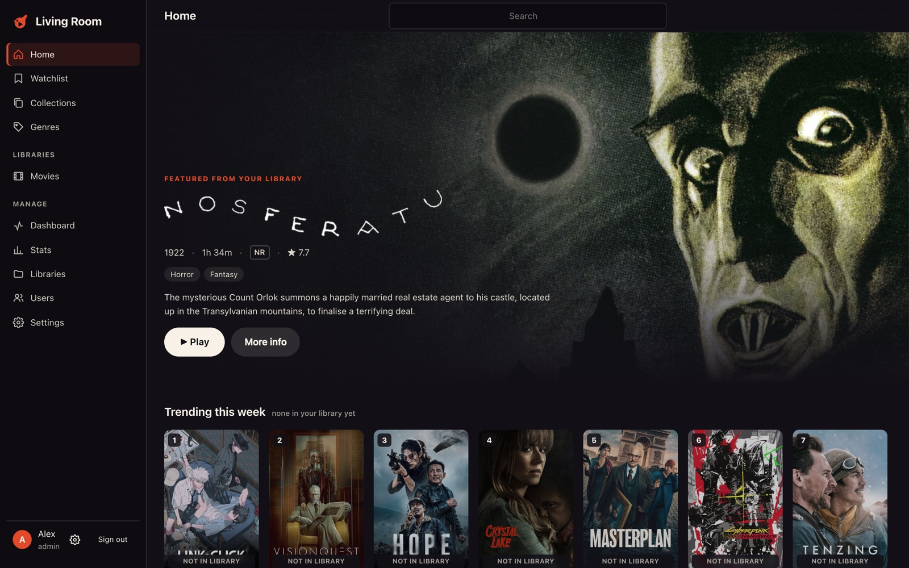
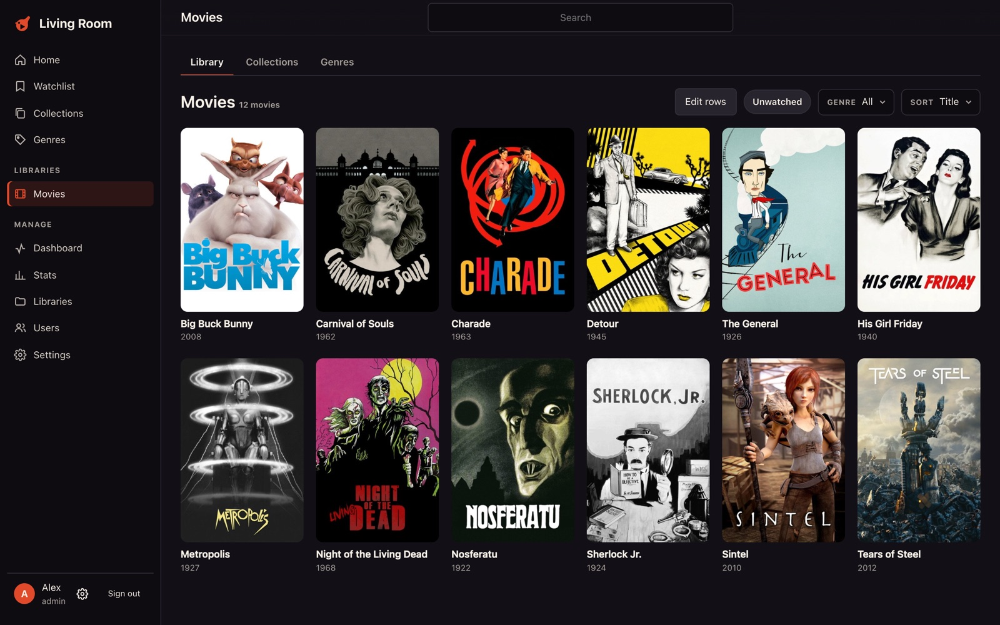
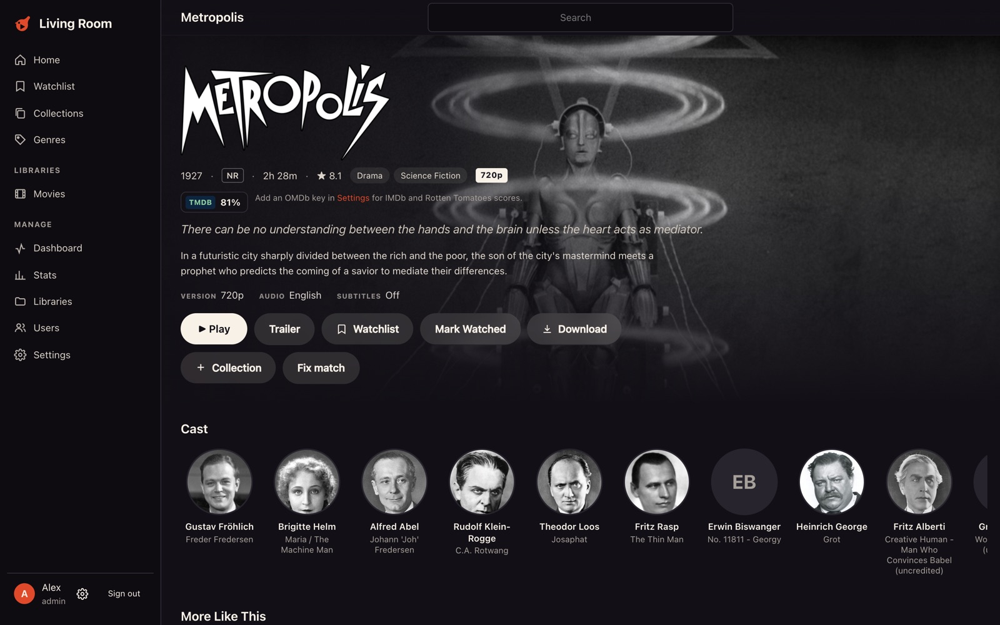

# Wren TV

**A free, self-hosted media server for your movies and shows: direct play at full quality, no ads, no paywalls.**

Dolby Vision, HDR10 and Dolby Atmos play untouched. The server transcodes only when a device truly can't play the
file, and hardware transcoding is free. Accounts are optional: run it fully offline with local usernames, or turn on
Wren TV accounts for Plex-style sharing and automatic remote access. Open source under the
[AGPL-3.0](LICENSE).



| Library | Title page |
|---|---|
|  |  |

## Highlights

- **Direct play first.** Remuxing keeps Dolby Vision and HDR10 and passes Atmos through. TrueHD/DTS becomes lossless
  ALAC instead of a lossy transcode. Transcoding is the last resort.
- **Free hardware transcoding.** VideoToolbox, NVENC, Quick Sync, VAAPI and AMF are auto-detected, and HDR→SDR tone
  mapping runs on the GPU.
- **No account required.** Local accounts work with no internet and no outside service. Wren TV accounts are an
  optional extra (sharing by email, signing in a TV with a QR code, remote HTTPS without a domain).
- **Apps for every screen.** Web, iPhone/iPad, Apple TV, Android, Android TV, macOS and Windows, with offline
  downloads on phones, tablets and the Mac.
- **Fast scans.** New episodes show up in seconds, and metadata fills in while you browse.
- **Optional debrid streaming.** With TorBox, AllDebrid or Real-Debrid, search any movie or show and play it
  Stremio-style, with per-user limits.
- **Built for backends.** Integration API, signed webhooks, and one static Go binary that runs on Docker, Linux,
  macOS and Windows.

## How it compares

| | Wren TV | Plex | Jellyfin | Emby |
|---|---|---|---|---|
| Price | Free | Free; Plex Pass for remote streaming, downloads, HW transcoding | Free | Free; Premiere for HW transcoding, downloads |
| Source code | Public | Closed | Open (GPL) | Closed |
| Account required | No (optional) | Yes | No | No (optional) |
| Works with no internet | Yes | Limited | Yes | Yes |
| Hardware transcoding | Free | Plex Pass | Free | Premiere |
| Dolby Vision + Atmos kept when remuxing | Yes | Partly | Partly | Partly |
| Remote HTTPS without a domain or proxy | Yes (with a Wren TV account) | Yes | No (reverse proxy) | No (reverse proxy) |
| Offline downloads on devices | Free | Plex Pass | Some apps | Premiere |
| Built-in debrid streaming | Yes | No | Plugins | No |
| Ads or promoted content | None | Yes | None | None |
| Music, photos, smart-TV apps (Roku, Samsung, LG) | Not yet | Yes | Yes | Yes |
| Maturity | New | Mature | Mature | Mature |

**Why not Jellyfin?** Jellyfin is great, and if it works for you, keep it. Wren TV is for people who want Plex's
polish and conveniences (one-tap sharing, QR sign-in on TVs, remote access with no setup) without Plex's
account requirement and paywalls, plus playback that keeps Dolby Vision and Atmos intact on Apple devices.

**Not there yet:** music, photos, and apps for Roku, Samsung, LG and game consoles. The iPhone and Apple TV apps are
in TestFlight beta. Wren TV is young, so expect rough edges and please [open an issue](https://github.com/LTAGROUP/WrenTV/issues).

## Quick start

### Docker

The image is published to GitHub Container Registry on every push to `main`:

```bash
docker pull ghcr.io/ltagroup/wrentv:latest
docker run -d --name wrentv -p 32500:32500 \
  -v ./config:/config -v /path/to/media:/media:ro \
  ghcr.io/ltagroup/wrentv:latest
```

Or use the compose file:

```bash
docker compose -f deploy/docker/docker-compose.yml up -d
```

Then open `http://<server>:32500`, create the owner account, and add a library (for example `/media/Movies`).
A free [TMDB API key](https://www.themoviedb.org/settings/api) in **Settings** gives you posters and metadata.

To update:

```bash
docker compose pull && docker compose up -d
```

Use `network_mode: host` on Linux so automatic port forwarding (UPnP) and LAN address detection see the real network.
Mount your media read-only. Config and the database live in `/config`. The image bundles jellyfin-ffmpeg; uncomment
`/dev/dri` (Intel/AMD) or the NVIDIA block in the compose file for hardware transcoding.

### Native

```bash
go build -o bin/wrentv ./cmd/wrentv
./bin/wrentv                 # run in the foreground
sudo ./bin/wrentv install    # install as a system service (systemd / launchd / Windows SCM)
./bin/wrentv start|stop|restart|status|uninstall|version
```

Requires `ffmpeg` and `ffprobe` on `PATH` (or set `transcode.ffmpeg_path`). On macOS, `brew install ffmpeg`.
Unit files: `deploy/systemd/wrentv.service`, `deploy/launchd/com.wrentv.server.plist`, `deploy/windows/README.md`.

### Apps

| Platform | Get it |
|---|---|
| Web | Built into the server at `http://<server>:32500` |
| macOS | [WrenTV-macOS.dmg](https://github.com/LTAGROUP/WrenTV/releases/latest/download/WrenTV-macOS.dmg) (updates itself) |
| Windows | [WrenTV-Windows-Setup.exe](https://github.com/LTAGROUP/WrenTV/releases/latest/download/WrenTV-Windows-Setup.exe) |
| Android | [WrenTV-Android.apk](https://github.com/LTAGROUP/WrenTV/releases/latest/download/WrenTV-Android.apk) |
| Android TV / Google TV | [WrenTV-AndroidTV.apk](https://github.com/LTAGROUP/WrenTV/releases/latest/download/WrenTV-AndroidTV.apk) |
| iPhone, iPad, Apple TV | [TestFlight beta](https://testflight.apple.com/join/VzW2XUBM) |

Full docs: [wrentv.com/docs](https://wrentv.com/docs/).

### Signing in

- **Wren TV accounts** (the default, see [below](#wren-tv-accounts)): people sign in with their email, and the apps
  find their servers automatically. Owners share by email. Admins can still add local accounts under
  **Sharing → Local accounts** for people who don't want a Wren TV account. Those users connect by address and sign
  in with their username.
- **Local accounts only** (`auth.mode: local`): the first person to open the server creates the owner account.
  Admins add everyone else under **Users**. In the apps, choose **Connect to a server by address**, enter the
  address, then sign in with the username and password.

### First run from the command line

```bash
curl -X POST localhost:32500/api/setup/owner -d '{"username":"me","password":"…"}'      # → {token}
curl -X POST localhost:32500/api/libraries -H "Authorization: Bearer $TOKEN" \
     -d '{"name":"Movies","type":"movies","paths":["/media/Movies"]}'
```

## Configuration

`wrentv.yaml` lives in the data directory and is created on first start:

| Platform | Data directory                         |
|----------|----------------------------------------|
| Docker   | `/config`                              |
| macOS    | `~/Library/Application Support/Wren TV` |
| Linux    | `/var/lib/wrentv` (root) or `~/.local/share/wrentv` |
| Windows  | `C:\ProgramData\WrenTV`                |

```yaml
server_name: Wren TV
listen: ":32500"
public_url: ""                 # externally reachable URL
integration_key: wtv_…         # generated; for backend services (X-WrenTV-Key)
auth:
  mode: supabase               # supabase (Wren TV accounts) | local (local accounts work in both)
remote_access:                 # automatic HTTPS addresses (Wren TV accounts only)
  enabled: true
  upnp: true                   # forward a port with UPnP / NAT-PMP
  public_port: 0               # a port you forwarded by hand (replaces UPnP)
metadata:
  tmdb_api_key: ""
  language: en-US
  workers: 8
transcode:
  ffmpeg_path: ffmpeg
  ffprobe_path: ffprobe
  hwaccel: auto                # auto | videotoolbox | nvenc | qsv | vaapi | amf | none
  vaapi_device: /dev/dri/renderD128
streaming:
  enabled: false
  torbox_key: ""
  alldebrid_key: ""
  realdebrid_key: ""
  provider_order: [torbox, alldebrid, realdebrid]
  addons:
    - { name: torrentio, url: "https://torrentio.strem.fun/manifest.json", enabled: true }
    - { name: comet, url: "https://comet.feels.legal/manifest.json", enabled: true }
  qualities: [2160p, 1080p]    # a stream is saved for each
  max_size_gb: { 2160p: 0, 1080p: 0 } # per file; 0 = any size
  prefetch: true               # find the rest of the season in the background
  mode: stream                 # stream | download (also save what's watched as files)
  movie_library: ""            # where downloads go (library ids)
  show_library: ""
  download_quality: 2160p
  limits:                      # 0 = no limit
    max_streams: 0             # debrid streams at once, all users
    bandwidth_mbps: 0          # all debrid traffic
    per_stream_mbps: 0
    download_mbps: 0
    max_downloads: 2           # server downloads at once
    prefetch_workers: 2
    download_quota_gb: 0
    min_free_gb: 20
users:                         # defaults; each user can override them
  max_streams: 0               # playbacks at once per user
  device_downloads: true
  max_downloads: 2             # device downloads at once per user
webhooks:
  - url: https://backend.example.com/wrentv
    secret: change-me
    events: [download.completed, download.failed, stream.unavailable]
scanner:
  watch: true
  poll_sec: 0                  # folder poll interval (0 = 5s macOS, 30s elsewhere)
  interval_min: 30             # full incremental rescan safety net
  probe_workers: 4             # -1 = probe on first play only (best for debrid/cloud mounts)
```

Environment overrides: `WRENTV_DATA_DIR`, `WRENTV_LISTEN`, `WRENTV_SERVER_NAME`, `WRENTV_PUBLIC_URL`,
`WRENTV_AUTH_MODE`, `WRENTV_TMDB_API_KEY`,
`WRENTV_FFMPEG`, `WRENTV_FFPROBE`, `WRENTV_HWACCEL`, `WRENTV_SCAN_POLL_SEC`, `WRENTV_STREAMING`,
`WRENTV_TORBOX_API_KEY`, `WRENTV_ALLDEBRID_API_KEY`, `WRENTV_REALDEBRID_API_KEY`,
`WRENTV_REMOTE_ACCESS`, `WRENTV_PUBLIC_PORT`, `WRENTV_ACME_DIRECTORY`, `WRENTV_DIRECT_API`.

## Streaming

Turn it on in **Settings → Streaming** in the web app or Mac app, add a debrid API key, and keep at least one addon.
Everyone who may stream (on by default, set per user) then sees two extra libraries, *Streaming Movies* and
*Streaming Shows*, and search results for titles the server doesn't have.

- Pressing play asks the addons for releases, keeps the ones your debrid service has **cached** (uncached releases
  are never downloaded), and plays the best match. Bytes always go through this server, so debrid links stay private.
- Season packs fill every episode they contain, and the rest of the season is looked up in the background.
- When a stored link stops working, the server re-adds the release; after repeated failures it forgets the stream and
  searches again. Admins can force this with **Find new streams** on a title.
- A file for the same movie or episode in a regular library takes precedence, and the streamed copy is hidden.
- Download mode (or **Download to server** on a title) saves streamed titles into the libraries you pick, named
  `Title (Year) {tmdb-ID}/…`. A disk quota and a free-space floor stop downloads before the disk fills.

Upgrading from a version with torrent support removes the torrent engine and its `/api/torrents` and
`/api/integration/torrents` endpoints, and deletes torrent-backed items. A Real-Debrid key from the old
`torrents.debrid` setting carries over.

## Integration API (for backend services)

Backends authenticate with the integration key: `X-WrenTV-Key: wtv_…`.

| Method | Path | Body |
|--------|------|------|
| GET    | `/api/integration/libraries` | |
| POST   | `/api/integration/libraries` | `{"name","type":"movies"|"shows","paths":[…]}` |
| POST   | `/api/integration/libraries/{id}/scan` | |

Webhooks are signed with the webhook secret:

```http
POST https://backend.example.com/wrentv
X-WrenTV-Event: download.completed
X-WrenTV-Signature: sha256=<hex HMAC-SHA256 of the body using the webhook secret>
```

```json
{
  "event": "download.completed",
  "id": "…",
  "timestamp": 1760000000,
  "server": { "id": "…", "name": "Wren TV", "url": "https://wrentv.example.com" },
  "data": { "id": "…", "itemId": "…", "title": "…", "quality": "2160p", "status": "done", "path": "/media/Movies/…", "bytes": 0, "total": 0 }
}
```

Events: `download.completed`, `download.failed` (a server download) and `stream.unavailable` (no cached release
was found for a title someone tried to play).

## Client API (summary)

Authenticate with `Authorization: Bearer <token>` (from `/api/auth/login`).

- `GET /api/home`: continue watching, next up and recently added, limited to the libraries the user can access.
- `GET /api/libraries`, `GET /api/libraries/{id}/items`, `GET /api/items/{id}`, `GET /api/items/{id}/children`, `GET /api/search?q=`
- `POST /api/items/{id}/play` with `{"caps": {...}, "audioIndex", "maxWidth"}` returns `{engine, method, url, …}`, or `202 pending` while a stream is being found
- `GET /api/discover/search?q=`: every matching movie and show, linked to library items; `POST /api/streaming/titles` `{"tmdbId","mediaType"}` adds one to the streaming library
- `POST /api/items/{id}/download` `{"fileId"}` returns a 24-hour link (`/download/<ticket>/<name>`) to the original file, or `202 pending`
- `POST /api/items/{id}/progress`, `POST /api/items/{id}/watched`, `DELETE /api/sessions/{sid}`
- `GET /api/events`: server-sent events (library changes, scan progress)
- `GET /api/me` includes the user's effective `limits`
- Admin: `/api/libraries` (CRUD and scan), `/api/users` (with per-user `limits`), `/api/admin/status`, `/api/admin/settings`,
  `/api/admin/downloads`, `/api/items/{id}/server-download`, `/api/items/{id}/streams`

## Wren TV accounts

Every server signs people in with the hosted Wren TV account service; there's nothing to set up. Open the web app,
sign in, and claim the server with the claim code printed in the server log. (`supabase/migrations/` is that
service's schema: profiles, server claiming, and sharing and invites.)

Local accounts keep working in this mode. Admins create them under **Sharing → Local accounts** (or `POST /api/users`),
and those people sign in by entering the server's address in the app and then their username and password.
`GET /api/server` reports `"localAccounts": true` so apps know to offer the username form.

### Remote access (automatic HTTPS)

A claimed server gets secure addresses without a domain or reverse proxy, like Plex's plex.direct:

- `https://192-168-1-20.<id>.wrentv.net:32500` for each LAN address, and
- `https://203-0-113-7.<id>.wrentv.net:<port>` for its public address, when it's reachable from the internet.

The server forwards a port on the router (UPnP or NAT-PMP, or `remote_access.public_port` for a manual forward),
asks the address service (`api.wrentv.net`, a Cloudflare Worker in the website repo) to publish the DNS records,
and gets a wildcard Let's Encrypt certificate for `*.<id>.wrentv.net` with a DNS-01 challenge. The certificate is
stored in `<data>/certs/direct/` and renewed automatically. HTTP and HTTPS share the listen port. The addresses are
published in the heartbeat (`local_urls` and `remote_url`), so the web player at watch.wrentv.com and the apps can
use them. Video always goes straight from the server to the viewer.

Behind CGNAT (an internet provider sharing one public IP between customers) the server is only reachable at home;
the settings page says so. Some routers block DNS answers that point to LAN addresses ("DNS rebinding protection"):
allow `wrentv.net` there, or viewers at home fall back to the public address.

## License

Wren TV is free software under the [GNU Affero General Public License v3.0](LICENSE). You can use, change and share
it. If you share a changed version, or run one as a service other people use over a network, you must make your
source code available under the same license.
